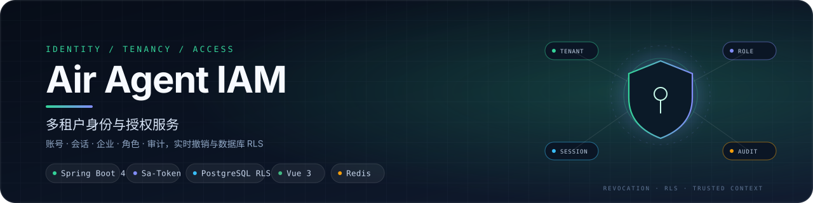
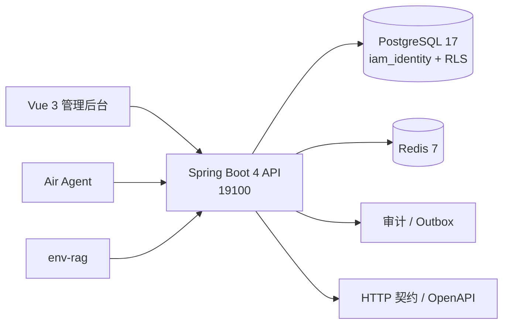

<p align="center">
  
</p>

<p align="center">
  
  
  
  
  
  
</p>

<p align="center">
  独立多租户 IAM：账号、会话、企业、角色、审计与服务账号，为 Agent / RAG 提供实时身份与业务授权。
</p>

<p align="center">
  <a href="#核心能力">核心能力</a> ·
  <a href="#架构">架构</a> ·
  <a href="#技术栈">技术栈</a> ·
  <a href="#本地运行">本地运行</a> ·
  <a href="#文档">文档</a>
</p>

# Air Agent IAM

正式本机环境由 Agent 仓的 `deployment/run_separated_local.py start` 统一管理三仓（Agent、IAM、RAG）。IAM 后端/管理前端为 `19100` / `19101`，PostgreSQL 为 `19132/iam_identity`，schema 仍是 `iam` / `iam_auth`。原 `291xx` 验收环境、I4 评测容器及旧 `iam` 数据库已退役，不再重建；下方历史报告、链接与评分仅供追溯。

用于学习企业账号、组织与鉴权的独立项目，提供中文管理后台、人类会话、企业/成员/部门、角色权限、审计、服务账号与 SSO。后端采用 **JDK 21 + Spring Boot 4 MVC + MyBatis + PostgreSQL + HikariCP + Flyway + Sa-Token + Redis**；前端采用 Vue 3、TypeScript、Vite、Pinia 和 Element Plus。

## 核心能力

- **多租户身份**：账号、企业、成员、部门、角色与权限；平台管理与企业管理员分离，企业切换带上下文版本校验。
- **会话与 SSO**：HttpOnly 不透明会话、CSRF 防护、Sa-Token 会话与 SSO 适配；会话可撤销，撤销即时生效。
- **实时身份核验**：内部端点以登记客户端凭据认证，签发短期运行票据；Agent / RAG 每次外呼前复查主体、企业与修订。
- **数据库隔离**：PostgreSQL RLS、FORCE RLS 与复合关联；请求角色与迁移角色分离，Flyway 管理增量迁移。
- **业务授权**：企业资源开通 ∩ 本企业角色授权；三项 Agent 业务复用统一 entitlement，不复制人员逐项 RBAC。
- **审计与运维**：身份审计、Outbox 事件、服务账号与凭据管理；密钥扫描与离线契约检查纳入提交前检查。

## 分支规范

本地开发与测试均在 `dev` 分支进行；只有功能完好（自测通过、构建与测试通过、密钥扫描零命中）的代码才会合并并推送到 `main` 分支，`main` 始终保持可交付状态。详见 [AGENTS.md](AGENTS.md)。

## 架构



## 技术栈

| 层 | 选型 | 说明 |
|---|---|---|
| 后端 | JDK 21 · Spring Boot 4.0 · MyBatis · Sa-Token | MVC、会话、权限与增量迁移 |
| 存储 | PostgreSQL 17 · Redis 7 | 身份权威状态、RLS 隔离与会话缓存 |
| 前端 | Vue 3 · TypeScript · Vite · Pinia · Element Plus | 中文管理后台与企业管理页 |
| 契约 | OpenAPI / HTTP Contract · Flyway | 内部核验、运行票据与版本化迁移 |
| 质量 | JUnit / Vitest · 密钥扫描 · OpenSpec | 单元/集成、提交前检查与规格校验 |
| 部署 | Apple Container · container-compose | 与 Agent / RAG 三仓统一启动 |

## 分层结构

按业务域组织，HTTP 入参、出参和数据库对象分别命名为 DTO、VO 和 DO：

```text
server/src/main/java/com/airagent/iam/
  admin/              企业、成员、部门、账号与角色
    controller/       HTTP 路由与参数边界
    service/          业务接口
      impl/           权限、规则和事务编排
    mapper/           MyBatis 数据访问接口
    dto/ vo/ entity/  入参、出参和持久化数据
  auth/               登录、会话、身份
  audit/              审计查询
  internal/           主体实时核验与运行票据
  serviceaccount/     服务账号及凭据
  webapi/             浏览器 Cookie、CSRF 和 SSO 适配
  common/             共用类型映射、事务上下文与事件 Mapper
server/src/main/resources/
  mapper/             对应 Mapper 的显式 XML SQL
  db/migration/       Flyway 迁移
```

Controller 不访问数据库，Service 不编写 SQL；SQL 使用绑定参数。MyBatis 关闭二级缓存并采用 STATEMENT 级一级缓存。授权变更、审计与 Redis 清理事件在同一事务中提交。请求数据库角色与迁移角色分离，数据库 RLS 约束租户范围。

命名、分层依赖、集合/空值、异常、事务和敏感字段处理按阿里巴巴 Java 规约整理；检查范围及剩余验收事项见[整改记录](docs/reviews/iam-remediation-plan.md)，不将局部自动检查等同于完整规约认证。

## 三仓关系

| 仓库 | 职责 |
|---|---|
| [air-agent](https://github.com/Acerola-1/air-agent) | Agent 运行时、聊天前端与运营后台 |
| [env-rag](https://github.com/Acerola-1/env-rag) | 环境标准/公报知识库与检索网关 |
| **air_agent_iam**（本仓） | 多租户身份、会话、企业与业务授权 |

## 本地运行

需要 JDK 21、Node.js 20.19+、PostgreSQL 17 和 Redis 7。按 `.env.example` 在本机配置 `.env.local`，分别设置请求与迁移数据库角色；账号和密钥只放本地配置。正式三仓启动入口（在 Agent 仓根目录执行）：

```sh
.venv/bin/python deployment/run_separated_local.py start
```

默认服务地址为 `http://127.0.0.1:19100`，管理前端为 `http://127.0.0.1:19101`，后台路径为 `/admin`，健康检查为 `/healthz`。首次管理员由本机 `IAM_BOOTSTRAP_ACCOUNT` / `IAM_BOOTSTRAP_PASSWORD` 配置创建。新企业默认以创建人为首位企业管理员，可在建立后切换企业继续管理。

`infra-up.sh` 默认仅配置正式库，不创建持久测试库。需要集成测试时，在 IAM 仓按需执行以下步骤；`test-db.sh` 只使用既有 `iam-pg17` 容器，并从本机 `.env.local` 核对迁移属主 `iam_migrate` / 请求角色 `iam_app`，只创建空库及 schema/必要授权，表由 Maven 测试启动的 Flyway 构建：

```sh
bash scripts/test-db.sh create
(
  set -a
  . ./.env.local
  set +a
  cd server
  IAM_REDIS_TEST_DB=1 ./mvnw test -Dspring.profiles.active=it
)
# 测试连接结束后显式清理（失败后也需清理）
bash scripts/test-db.sh drop

(cd web && npm test && npm run build)
```

server 测试 profile `it` 固定连接独立的 `iam_test` 及 Redis DB1；`iam_test` 只存可丢弃测试数据，不作为正式数据源。创建时若库已存在则失败；删除仅限 `iam_test`，拒绝活跃连接，不使用 FORCE。脚本不会自动执行，也不接受其他库名。旧在线 `verify-{dr-restore,perf-introspection,session-authority,internal-principals,admin-apis,web-session,acceptance-matrix}.sh` 已在读取配置及任何在线操作前退出 2，主体保留为历史参考。离线契约、密钥扫描、加密向量及 Gate 检查继续保留。

部门创建/修改必须提交表单打开时的 `tenant_id` 和 `expected_ctx_version`，过期表单返回 409。内部端点以登记的客户端 Bearer 凭据认证调用服务，`subject_token` 表示待核验主体；保留 Basic 兼容入口。原 rt-v1 采用 `{kid,p}` 信封的两段格式。

## 测试凭据在哪里

真实账号与密钥一律只存本地、不入库（入库前由 `scripts/verify-secret-scan.sh` 强制零命中）。正式本机环境凭据在 `.env.local`；历史 `iam-audit-20261015.local` 对应已退役的 `291xx` 验收环境，不是现行配置，不再建议恢复或重建该环境。

## Agent 业务授权

当前三项 Agent 业务（基础问答、数据分析、智能溯源）复用企业资源开通与企业角色授权；有效许可为企业开通与本人企业角色授予的交集。中文配置路径、root 一次性授权命令及第二阶段发布检查/清理/复验命令见 [Agent 业务授权](docs/agent-business-entitlements.md)。

## 文档

| 文档 | 内容 |
|---|---|
| [AGENTS.md](AGENTS.md) | 开发分支、提交前检查与正式运行边界 |
| [正式环境](docs/CURRENT-RUNTIME.md) | 三仓唯一运行态清单与端口 |
| [HTTP 契约](openspec/changes/establish-shared-iam-service/http-contract.md) | 会话、内部核验与错误语义 |
| [Agent 业务授权](docs/agent-business-entitlements.md) | 企业开通、角色授予与权限码 |
| [openspec/](openspec/) | 规格驱动的变更、设计与归档 |

## 设计与证据

- [HTTP 契约](openspec/changes/establish-shared-iam-service/http-contract.md)
- [整改前独立审计](docs/reviews/iam-independent-acceptance.md)
- [分层迁移与整改](docs/reviews/iam-remediation-plan.md)
- [最新复验与已知性能项](docs/reviews/iam-remediation-validation.md)
- [I1a资源开通与授权修复复验](docs/reviews/iam-i1a-takeover-validation.md)
- [I1a资源授权HTTP契约与I2/I3边界](openspec/changes/add-tenant-resource-entitlements/http-contract.md)
- [原设计与阶段划分](openspec/changes/establish-shared-iam-service/design.md)

以上报告记录 I1a 阶段结论：通用资源开通、角色/成员及服务账号资源授权已实现，核心流程复验通过；当时完整资源负载性能、兼容回退版本及部分竞争矩阵仍待验证，Python 消费者切换（I2/I3）与物理拆库属于后续阶段。历史范围不代表现行部署状态，当前运行入口以上方三仓管理脚本为准。

## License

[MIT](LICENSE)
